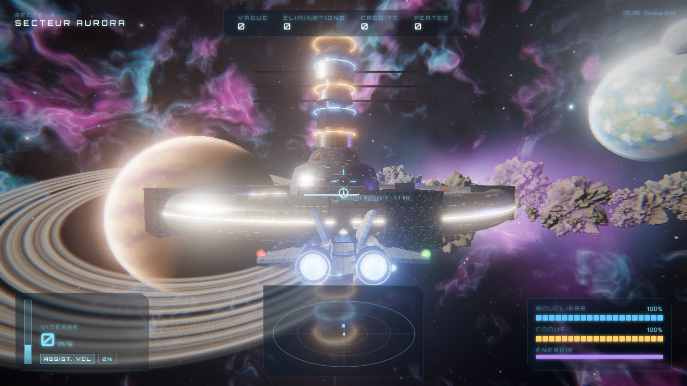
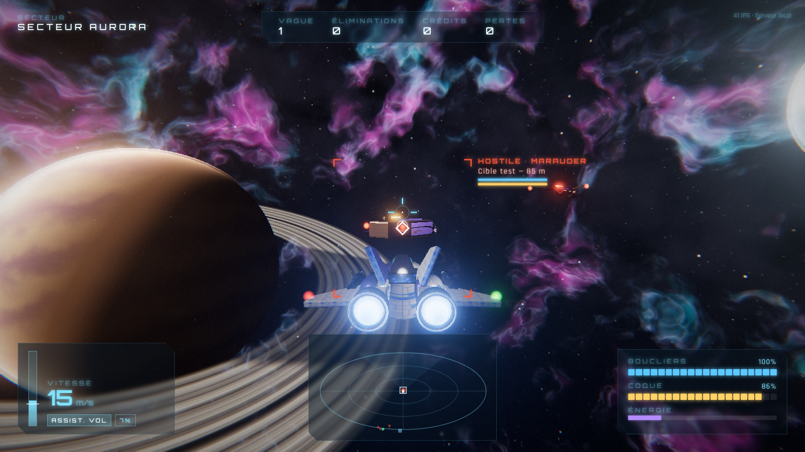

# NEBULA FRONTIER

MMO spatial 3D dans le navigateur (Three.js + TypeScript + Vite).
Version actuelle : **v0.8, collisions physiques**. Plusieurs pilotes partagent deux secteurs en temps réel, reliés par saut hyperspatial, avec un serveur Node.js autoritaire. On y mine, on commerce entre quatre stations, on remplit des contrats, on améliore son vaisseau ou on en achète un autre, et la progression est sauvegardée. Tout ce qui est solide se heurte vraiment. Le mode solo hors ligne reste disponible.



## Lancer le jeu

```bash
npm install
npm run server     # serveur multijoueur sur http://localhost:8080 (sert aussi le client s'il est construit)
npm run dev        # client de développement sur http://localhost:5173 (se connecte au serveur :8080)
```

Pour jouer à plusieurs en local : `npm run build && npm run server`, puis ouvrir http://localhost:8080 dans deux onglets ou sur deux ordinateurs du même réseau (`http://<ip-de-la-machine>:8080`).

Options d'URL :
- `?q=low` : qualité réduite pour les petites configurations.
- `?server=wss://…` : autre serveur.
- `?lag=120&jitter=20` : latence simulée en millisecondes.
- `?autostart` : démarrage direct en solo.
- `?colliders` : formes de collision dessinées par-dessus le décor.

Mise en ligne : voir [docs/DEPLOIEMENT.md](docs/DEPLOIEMENT.md). Le client reste sur Vercel, et le serveur WebSocket va sur Render, Fly.io ou un VPS.

## Collisions physiques (v0.8)

- **On ne traverse plus rien** : les murs des stations, les astéroïdes (avec la forme qu'on voit), les autres vaisseaux et les objets libres arrêtent un vaisseau, même au boost.
- **Le choc dépend de la vitesse, de la masse, de l'angle et de la matière** : à 5 m/s on touche sans dégâts, à 200 m/s contre du métal le vaisseau est détruit. Métal, roche, fer-nickel, glace et coques rebondissent, glissent, sonnent et étincellent chacun à leur façon.
- **Dégâts localisés** : cockpit (verrière fissurée), ailes, moteurs, chacun avec ses effets en vol, réparés à la station.
- **Objets libres** : caisses, conteneurs, épaves et rochers qu'on pousse, qui tournent, rebondissent et cassent.
- Détails : [docs/V08_COLLISIONS.md](docs/V08_COLLISIONS.md).

## Exploration (v0.7)

- **Secteur Kepler**, à un saut d'Aurora : la station Kepler-4, le dépôt de glace Vesta-2, une ceinture riche en métal et en platine, des raids plus durs.
- **Saut hyperspatial** (`J`, bouton **SAUT** sur écran tactile) : à plus de 1,5 km des stations, 6 s de charge, la moitié du condensateur, puis 20 s de recharge.
- **Entre secteurs** : nouvelles routes commerciales, livraisons vers l'autre secteur mieux payées. La liste des pilotes indique le secteur de chacun ; le chat est commun.
- Détails : [docs/V07_SECTEURS.md](docs/V07_SECTEURS.md).

## Missions (v0.6)

- **Onglet « Missions »** en station : chaque station propose 4 contrats, et un pilote peut en mener 3 à la fois.
- **Livraison** de caisses à l'autre station, **minage** d'un minerai à rapporter, **chasse** aux pirates.
- En ligne, le tableau est commun : un contrat pris disparaît pour les autres. Le suivi s'affiche en vol, sous le nom du secteur.
- Détails : [docs/V06_MISSIONS.md](docs/V06_MISSIONS.md).

## Vaisseaux et améliorations (v0.5)

- **Chantier** : un onglet de l'écran de station, à côté du marché.
- **Améliorations** : canons, boucliers, blindage, moteurs, soute et rayon de minage, trois niveaux chacun (500, 1 400 puis 3 200 cr sur le Falcon). Elles s'installent dans toutes les stations et changent vraiment la simulation, côté serveur comme dans la prédiction du client.
- **Deuxième vaisseau** : le Warden, un transporteur (soute de 60 au lieu de 40, plus lent et moins armé), vendu 2 000 cr au chantier d'Aurora-7. On passe d'un vaisseau à l'autre à quai ; chacun garde sa coque et ses améliorations.
- Le Warden reprend le modèle 3D de l'escorte alliée : de nouveaux modèles viendront plus tard. Détails : [docs/V05_VAISSEAUX.md](docs/V05_VAISSEAUX.md).

## Comptes et sauvegarde (v0.4)

- **Compte pilote** : pseudo et mot de passe, sans e-mail. Le navigateur garde la session 30 jours.
- **Progression** : crédits, soute, score, coque et station de retour. On revient à quai là où on s'est amarré la dernière fois, même après un redémarrage du serveur. Les stocks des stations sont gardés aussi.
- **Solo** : la progression reste dans le navigateur, séparément du compte en ligne.
- Base PostgreSQL (Neon) côté serveur. Détails : [docs/V04_PERSISTANCE.md](docs/V04_PERSISTANCE.md).

## Économie (v0.3)

Amarrage aux stations Aurora-7 et Ferro-9, minage d'astéroïdes, commerce avec des prix qui suivent les stocks, réparations. Détails : [docs/V03_ECONOMIE.md](docs/V03_ECONOMIE.md).

## Multijoueur (v0.2)

- **Connexion** : « Jouer en ligne » (avec un compte) ou « Solo hors ligne ». Le menu indique si le serveur répond et combien de pilotes sont connectés.
- **Synchronisation** : positions, rotations, vitesses, poussée et boost, tirs, boucliers, coque, dégâts, destructions, réapparitions et PNJ. Tout est calculé par le serveur.
  - Le vaisseau du joueur est prédit localement, puis réconcilié avec le serveur.
  - Les autres vaisseaux sont interpolés.
- **Coopération** : les joueurs combattent ensemble les mêmes pirates. Les raids pirates grossissent avec le nombre de pilotes.
- **PvP volontaire** (`P`) : deux pilotes ne peuvent s'affronter que si tous deux l'ont activé. Une élimination PvP ne rapporte pas de crédits.
- **Chat du secteur** :
  - `Entrée` pour écrire, `H` pour masquer ou afficher.
  - Historique récent et protection contre le spam.
  - La souris continue de piloter pendant la saisie.
- **Interface** : état de la connexion, nombre de pilotes, latence, pseudo, noms au-dessus des vaisseaux, liste des pilotes (`Tab`), messages d'arrivée et de départ.
- **Déconnexions** : le vaisseau d'un pilote déconnecté coupe ses moteurs, puis disparaît après 20 s. En revenant dans ce délai (même onglet, ou rechargement de la page), on retrouve son vaisseau en vol ; plus tard, on revient à quai avec sa progression.

## Contenu de la v0.1

- **Secteur Aurora** : ciel de nébuleuse procédural (cubemap calculée au démarrage, sert aussi de reflets), soleil avec lens flare, géante gazeuse annelée, planète océanique, lune glacée, ceinture de plus de 500 astéroïdes, nuages de poussière.
- **Station Aurora-7** : un kilomètre d'envergure, anneau d'habitation rotatif, épine centrale, hangar d'appontage balisé, panneaux solaires, balises clignotantes, navettes en circulation.
- **Vaisseaux** : Falcon Mk.II (joueur), Warden (escorte alliée), Raider et Marauder (pirates), entièrement modélisés en procédural avec réacteurs animés, feux de navigation et bulle de bouclier qui réagit aux impacts.
- **Pilotage** : physique newtonienne avec assistance de vol (dérive et inertie visibles), mode newtonien pur (`Z`), boost qui consomme l'énergie, translations latérales et verticales, roulis, joystick virtuel à la souris.
- **Combat** : lasers balistiques, boucliers qui se régénèrent après un délai, coque, collisions, indicateur de tir anticipé, verrouillage de cible, raids pirates espacés par des périodes de calme, ailiers IA, réapparition à la station, primes en crédits.
- **IA** : poursuite avec visée anticipée imparfaite, manœuvres d'évitement, choix de cible, évitement des obstacles.
- **Effets** : bloom HDR, explosions (boule de feu, étincelles, onde de choc, débris, fumée), traînées, poussière spatiale qui donne la sensation de vitesse, tremblements de caméra, aberration chromatique.
- **HUD** : vitesse, poussée, assistance, boucliers, coque, énergie, radar 3D, marqueurs, cible avec barres de vie, flèche hors écran, notifications.
- **Son** : moteur en couches, armes par classe, impacts, explosions par taille, ambiances, musique adaptative générative, annonces de bord, réglages par groupe (musique, effets, ambiances, interface, annonces). Tout est synthétisé en Web Audio, sans fichier audio : voir [docs/AUDIO.md](docs/AUDIO.md).



## Commandes

Les touches correspondent à des positions physiques : sur un clavier AZERTY, `W/A/S/D` se jouent avec `Z/Q/S/D`, et `Q/E` avec `A/E`. Le menu du jeu affiche automatiquement les bonnes lettres dans Chrome et Edge.

| Touche | Action |
| --- | --- |
| Souris | Piloter (joystick virtuel) |
| Clic gauche / `F` | Tirer |
| `W` / `S`, molette | Poussée + / − |
| `A` / `D` | Translation latérale |
| `Espace` / `C` | Translation verticale |
| `Q` / `E` | Roulis |
| `Maj` | Boost |
| `X` | Couper les gaz |
| `Z` | Assistance de vol on/off |
| `T` | Cible suivante |
| `V` | Caméra (poursuite, proche, cinématique) |
| Flèches | Tangage / lacet au clavier |
| `M` | Couper le son |
| `Entrée` / `H` | Chat : écrire / masquer (en ligne) |
| `P` | PvP on/off (en ligne) |
| `G` | S'amarrer / décoller |
| `R`, clic droit | Rayon de minage |
| `J` | Saut hyperspatial vers l'autre secteur (encore : annuler) |
| `Tab` (maintenir) | Liste des pilotes |
| `Échap` | Pause : reprendre, commandes, options et son |

Toutes les touches se réaffectent dans **Échap → Commandes** (affichage AZERTY ou QWERTY au choix). Les réglages (touches, volumes, sensibilité, inversion verticale) sont enregistrés dans le navigateur.

### Téléphone et tablette

Sur un écran tactile, le jeu affiche ses commandes à l'écran. Il se joue en mode paysage ; tenu à la verticale, un téléphone affiche « Tournez votre appareil ».

| Commande | Action |
| --- | --- |
| Pouce gauche, glisser | Piloter (le joystick apparaît sous le doigt) |
| Curseur **GAZ** | Poussée (en bas du trait blanc : marche arrière) |
| **FEU** / **BOOST** (maintenir) | Tirer / boost |
| **CIBLE**, **STOP**, ⟲ ⟳ | Cible suivante, couper les gaz, roulis |
| **ASSIST.**, **II** | Assistance de vol, pause |
| **CHAT**, **PVP**, **PILOTES** | En ligne : écrire, PvP on/off, liste des pilotes |
| **S'AMARRER**, **SAUT** | Près d'un hangar : s'amarrer. Loin des stations : saut hyperspatial |

Sur mobile, la qualité graphique basse est choisie par défaut (`?q=high` pour la forcer). `?touch` affiche les commandes tactiles sur un ordinateur.

Le tir et le boost consomment l'énergie du condensateur. Elle ne se recharge que 0,6 s après le dernier tir et hors boost ; si elle tombe à zéro, les armes et le boost restent hors ligne jusqu'à 30 % (« ÉNERGIE ÉPUISÉE · RECHARGE » dans le HUD, avec une alerte de bord).

## Architecture

```
src/
  shared/          Code commun client + futur serveur (aucun DOM, aucun rendu)
    sim/           World (simulation autoritaire à 60 Hz), physique, combat, IA, zone
    net/protocol   Messages client/serveur, snapshots, validation des entrées
  server/          GameServer : sessions, IA, raids pirates, réapparitions, chat, PvP, économie (indépendant du transport)
    accounts/      Comptes pilotes : mots de passe, jetons, limites, stockage mémoire ou PostgreSQL
    node/          Serveur Node.js : HTTP + WebSocket /ws, configuration par variables d'environnement
  client/
    net/           Transport (frontière réseau), LocalTransport (solo), WebSocketTransport (en ligne), prédiction, interpolation
    ui/            Menu (connexion / inscription, en ligne / solo, pause, commandes, options), chat, écran de station
    render/        Ciel, planètes, astéroïdes, station, vaisseaux, lasers, effets, post-traitement
    hud/ input/ camera/ audio/
tests/             Tests Vitest : simulation, serveur, réseau (vrais WebSockets), prédiction, comptes, sauvegardes, PostgreSQL
scripts/           Tests de bout en bout dans Chromium (WebGL logiciel)
```

Principes, détaillés dans [docs/ARCHITECTURE.md](docs/ARCHITECTURE.md) :

1. **Le serveur fait autorité.** Le client n'envoie que des entrées (`ShipInput`) ; toute la physique, les tirs et les dégâts sont calculés par `World`.
2. **Même code partout.** `src/shared` tourne tel quel dans Node : le futur serveur multijoueur réutilisera `GameServer` derrière un transport WebSocket.
3. **Frontière réseau explicite.** Le client ne parle qu'à une interface `Transport`. Aujourd'hui `LocalTransport` exécute le serveur dans la page ; demain un `WebSocketTransport` le remplacera sans toucher au reste du jeu.
4. **Monde déterministe.** La zone (astéroïdes, planètes, station) est générée à partir d'une graine : le serveur et chaque client construisent exactement le même univers.

## Vérification

```bash
npm run typecheck   # TypeScript strict
npm test            # tests : physique, collisions, combat, énergie, raids, réglages, serveur, réseau, prédiction, comptes, sauvegardes
TEST_DATABASE_URL=postgres://… npm test   # en plus : le stockage PostgreSQL sur une base jetable (ses tables nf_* sont effacées)
npm run build       # build de production
npm run preview &   # puis :
npm run smoke       # lance le jeu dans Chromium headless, pilote, tire et fait des captures
npm run ui-check    # HUD à 3 tailles, menu pause, réaffectation, réglages, tirs, amarrage, commerce, minage, sauvegarde solo, chantier, contrats
node scripts/mp-check.mjs    # navigateurs sur le vrai serveur : inscription, synchro, chat, combat commun, PvP, latence, reconnexion, connexion refusée puis acceptée
node scripts/mobile-check.mjs   # téléphone et tablette émulés : commandes tactiles, mise en page, chat et PvP en ligne
node scripts/jump-check.mjs     # saut hyperspatial en solo : HUD, charge, Kepler, retour, mémoire graphique, bouton tactile
node scripts/collision-check.mjs   # collisions : mur, astéroïde, deux vaisseaux, faible et violent, aile et cockpit, caisse, puis deux navigateurs en ligne
node scripts/load-test.mjs 30 30   # 30 pilotes robots pendant 30 s : coût du tick et bande passante
```

Pour `npm run smoke`, définir `CHROMIUM_PATH` si Chromium n'est pas trouvé automatiquement.

## Feuille de route

- **v0.2 : multijoueur.**
- **v0.3 : amarrage, minage et commerce.**
- **v0.4 : comptes pilotes et sauvegarde.**
- **v0.5 : vaisseaux et améliorations.**
- **v0.6 : missions.**
- **v0.7 : exploration, un deuxième secteur et le saut hyperspatial.**
- **v0.8 : collisions physiques** (cette version).
- Ensuite : factions et réputation, carte de la galaxie et autres secteurs, version PC installable.
